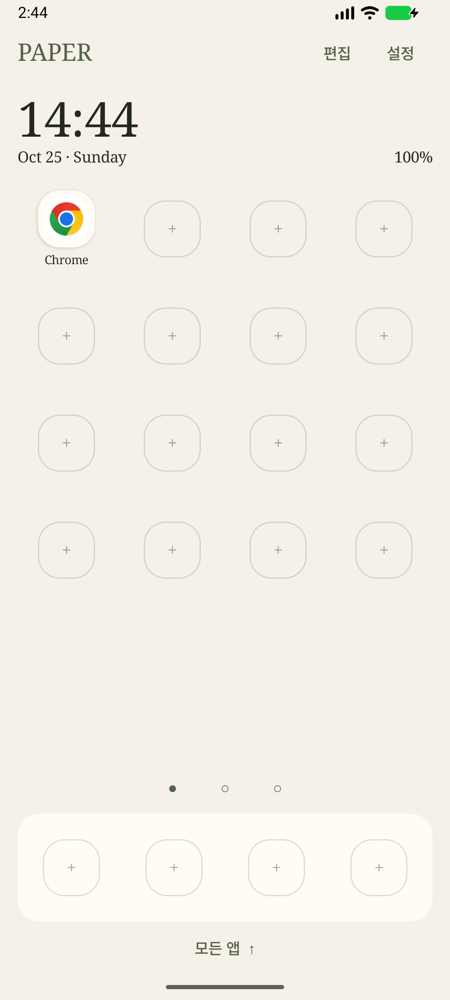
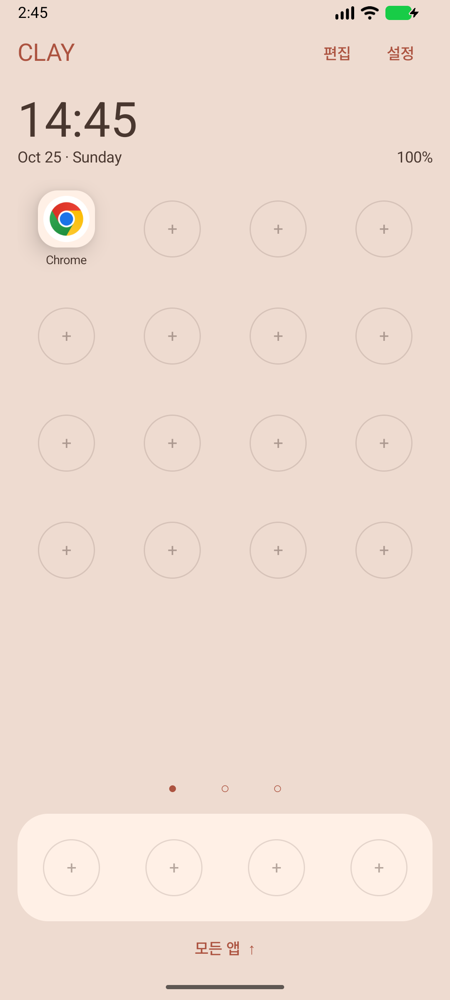
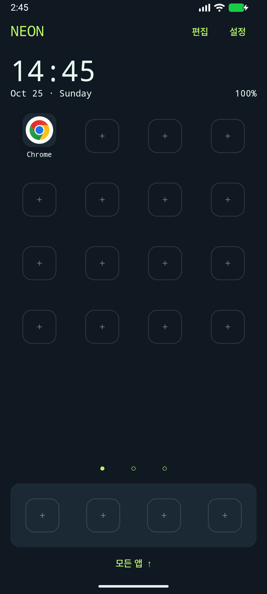

# Launcher Atlas

Three Android home screens built from one shared Kotlin / Jetpack Compose core.

| Launcher | Direction | Source |
|---|---|---|
| Paper | Quiet colors, serif typography, restrained motion | [Paper](launchers/paper) |
| Clay | Warm colors, rounded shapes, soft depth | [Clay](launchers/clay) |
| Neon | Dark surfaces, bright accents, perspective transitions | [Neon](launchers/neon) |

| Paper | Clay | Neon |
|---|---|---|
|  |  |  |

These are actual Android 16.1 **emulator** captures using installed app icons. Physical-device verification and a human-approved AI icon set remain pending.

## Build

Install JDK 17 and Android SDK platform 36 / build-tools 36.0.0. Set `ANDROID_HOME` (or a local, uncommitted `local.properties`). From this directory:

```sh
./gradlew testDebugUnitTest assembleDebug lintDebug
```

Windows: use `gradlew.bat`. APKs are in `launchers/<id>/build/outputs/apk/debug/`. These are **development APKs**, not production signed releases. The three application IDs are distinct, allowing side-by-side installation. No private Factory dependency is needed.

## What is supported

Android 12+ phones in portrait, current personal profile, default HOME selection, app drawer/search/launch, editable pages and dock, folders, clock/date/battery, original app icon fallback, bundled image mappings, wallpaper application, and reduced motion. Home layout is saved separately from the default style SPEC. Updating the style preserves an existing user's grid and placement; reset is explicit.

Third-party widgets, replacement of system authentication, Recents integration, work/private profiles and a real-time 3D engine are outside this release. Lock wallpaper does not replace the system lock screen. Browser previews are approximate; Android rendering is authoritative.

## Assets and verification status

The starter designs use **original installed app icons**. They do not contain a completed AI-generated icon set. Approved image assets can be added through a versioned manifest with hashes, source and distribution terms. Never treat the sample styles as evidence of image generation feasibility.

See [verification and release checklist](docs/release.md). Pixel/Galaxy physical-device testing and real-device promotional videos must be completed before a public release; no hardware compatibility is claimed until recorded. Download links are added only after a release actually exists.

## 한국어

공통 코어와 작품별 `launcher.json`·리소스로 구성한 런처 모음입니다. 위 명령으로 세 앱을 빌드하고 설치한 뒤 시스템에서 기본 홈으로 선택할 수 있습니다. 앱 서랍에서 앱을 길게 누르면 홈에 추가하며, 홈 아이템을 길게 누르면 이동·폴더·제거 작업을 할 수 있습니다. 드래그로 셀과 dock 사이를 이동할 수 있습니다. 초기 배치는 실제 설치 앱에 맞춰 사용자가 구성합니다.

코드는 MIT이며 외부 리소스의 배포 조건은 각 manifest를 따릅니다. 제작 도구·참조 이미지·프롬프트·서명키는 이 공개 트리에 포함하지 않습니다.
