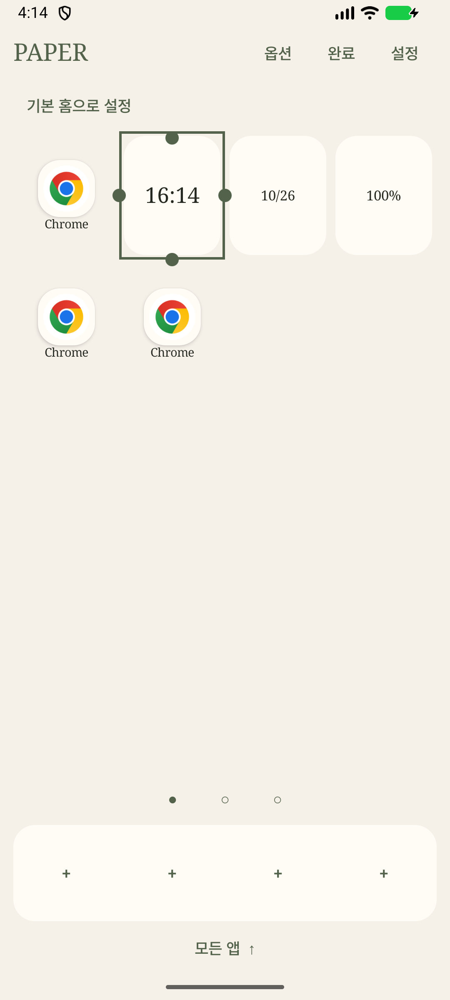

# v2.0.1 — Long Press 선택과 네 방향 resize

Cell을 길게 누르면 숫자 메뉴 대신 포인트 색 외곽선으로 선택합니다. 상·하·좌·우 핸들로 크기를 바꾸고 본체를 끌어 이동합니다. 앱·고정 provider·앱 포함 Stack·Dock의 크기 제약은 유지합니다. 옵션 버튼에서 폴더·Stack·제거를 편집하며 빈 공간·뒤로가기·완료로 선택을 해제합니다.

허용 크기에서는 콘텐츠도 미리보기하고 유효한 drop에만 한 번 저장합니다. 충돌·경계·경첩·provider 제약 위반과 취소는 원래 배치를 유지합니다. 왼쪽·위쪽 조절은 반대편 경계를 고정합니다. Schema2와 runtime 위젯 binding ID는 유지하며 세 앱은 versionCode3 / versionName2.0.1입니다.

## 검증

- JVM31 tests: 네 방향 기하, 최소1Slot, 충돌 rollback, provider 축과 Stack 제약, 기존 workspace 회귀.
- Android UI15 tests: 선택·숫자 메뉴 미노출·핸들 drop1회 저장, 앱 실행 차단, resize 취소/충돌, 본체 이동 cancel/invalid 무저장, 기존 검색/폴더·Stack·reset.
- 실제 AppWidgetHost + fixture RemoteViews: 버튼/ListView 스크롤 유지, native Long Press 선택과 연속 drag, binding 보존, 정적 TextView의 짧은 탭과 Long Press 구분.
- Factory44 tests, 공통 코어와 세 앱 build/lint, 새 독립 export에서 세 앱 test/build/lint 통과.
- 전용 API36.1 에뮬레이터에 세 versionCode3 앱 업데이트 설치, 실제 홈에서 Long Press 후 네 핸들 표시를 확인하고 위 화면을 캡처.

최종 읽기 전용 리뷰 후 본체 ACTION_CANCEL 저장, 정적 widget의 DOWN 미처리에 따른 지연 선택, invalid 이동의 불필요한 저장을 재현 테스트 RED→GREEN으로 수정했습니다. 페이지/profile이 바뀌면 pending gesture도 취소합니다.

위젯 검사는 emulator-only fixture이며 실제 OEM 위젯·물리 기기 조작성의 수용 결과를 대신하지 않습니다. 이번 실행에서 Galaxy는 미연결이므로 APK 준비와 에뮬레이터 검증을 물리 기기 설치로 보고하지 않습니다.
